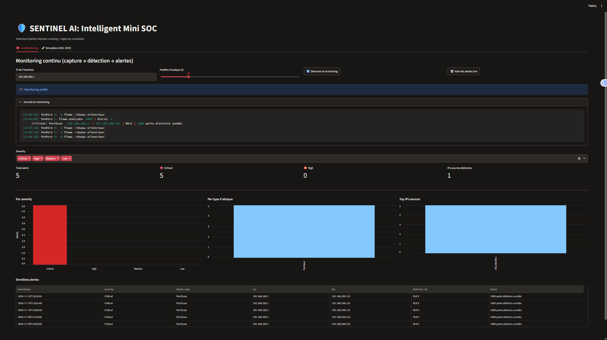

# 🛡️ SENTINEL AI : Intelligent Mini SOC

Mini SOC (Security Operations Center) qui surveille le trafic réseau, détecte les activités suspectes avec du **Machine Learning** et des **règles de corrélation**, classe la gravité des alertes et les affiche dans un **dashboard** mis à jour en continu.

> Projet réalisé dans le cadre d'un PFE en cybersécurité. Auteur : *Aya Ouerhani*



## Architecture

```
 Trafic réseau ──► Scapy (sniff + flows) ──► Features ──►  ┌─────────────────────┐
 (carte réseau)                                            │  ML (Random Forest) │
                                                           │  + Règles (PortScan)│
                                                           └─────────┬───────────┘
                                                                     ▼
                                       Sévérité (Low → Critical) ──► SQLite ──► Dashboard Streamlit
```

Deux pipelines :

| Pipeline | Données | Modèles |
|---|---|---|
| **Simulation** | NSL-KDD (rejeu de connexions) | Random Forest + Isolation Forest (hybride) |
| **Live** | Capture Scapy sur une vraie interface | Random Forest entraîné sur **CIC-IDS2017** + règle de corrélation *PortScan* |

## Stack technique

Python 3.14 · Scikit-learn · Scapy (+ Npcap) · Pandas · Streamlit · Altair · SQLite · Git/GitHub

## Structure du dépôt

```
sentinel-ai/
├── src/
│   ├── monitor.py              # monitoring continu : boucle capture -> détection
│   ├── capture/sniff.py        # capture Scapy -> flows (data/flows_live.csv)
│   ├── model/
│   │   ├── common.py           # chargement NSL-KDD
│   │   ├── train.py            # Random Forest NSL-KDD (baseline)
│   │   ├── train_hybrid.py     # Isolation Forest (entraîné sur trafic normal)
│   │   ├── evaluate.py         # comparaison RF / IF / hybride
│   │   ├── detect.py           # moteur de détection (simulation) + sévérité + SQLite
│   │   ├── explore_cic.py      # exploration/nettoyage CIC-IDS2017
│   │   ├── train_cic.py        # Random Forest par familles d'attaques (CIC)
│   │   ├── predict_live.py     # prédiction ML sur les flows capturés
│   │   └── detect_live.py      # détection live : ML + règle PortScan -> SQLite
│   └── dashboard/app.py        # dashboard Streamlit (Live Monitoring + Simulation)
├── models/                     # modèles .joblib (non versionnés)
├── data/                       # datasets, flows, base SQLite (non versionnés)
├── docs/dashboard.png          # capture d'écran du dashboard
└── requirements.txt
```

## Monitoring continu

`src/monitor.py` tourne en boucle sur une interface réseau :

1. capture le trafic pendant une fenêtre (10 à 60 s, `sniff.py`) ;
2. regroupe les paquets en flows et lance la détection (`detect_live.py`) : modèle ML + règle de corrélation PortScan ;
3. écrit les alertes dans SQLite (`live_alerts`) ;
4. recommence avec la fenêtre suivante.

Le dashboard (onglet **Live Monitoring**) démarre et arrête le monitoring avec un bouton, affiche le journal et se rafraîchit toutes les 5 secondes. En ligne de commande :

```powershell
python src\monitor.py <IP_de_l_interface> [fenetre_en_secondes]
```

### Règle PortScan

Pour chaque couple (source, destination), on compte les ports TCP distincts sondés par des flows **sans données** (≤ 3 paquets, 0 octet de payload). À partir de **20 ports** : alerte *High* ; à partir de **100 ports** : alerte *Critical*.

## Résultats

### NSL-KDD (jeu de test, binaire Normal/Attaque)

| Modèle | Précision attaque | Recall attaque | F1 |
|---|---|---|---|
| Random Forest | 0.969 | 0.631 | 0.764 |
| Isolation Forest (contamination 0.2) | 0.896 | 0.832 | 0.863 |
| **Hybride RF + IF (0.05)** | **0.968** | 0.749 | 0.844 |

L'hybride garde la précision du Random Forest tout en augmentant le recall de ~12 points (les attaques nouvelles sont mieux détectées).

### CIC-IDS2017 (2,8 M de flows, split aléatoire stratifié 70/30)

Accuracy 0.996 · F1 macro 0.913. Familles : Normal, DoS, DDoS, PortScan, BruteForce, Bot.
Classe faible : **Bot** (précision 0.384, très peu d'exemples).

### Tests en conditions réelles (lab)

| Test | Résultat |
|---|---|
| Trafic normal (navigation, YouTube, plusieurs captures) | **0 alerte** |
| `nmap -sS -p 1-1000` sur une VM de test (capture manuelle) | **1 alerte Critical « PortScan »** (1000 ports distincts sondés) |
| Même scan pendant le monitoring continu | Alerte **Critical « PortScan »** levée dans la fenêtre d'analyse concernée |

## Limites (honnêtes)

- **Écart dataset ↔ réseau réel** : les flows extraits avec Scapy diffèrent de ceux de CICFlowMeter. Après correction du calcul des octets (payload sans padding Ethernet), le modèle ML seul **ne détectait plus les flows d'un scan** (1/1000) : d'où la **règle de corrélation PortScan**. L'approche finale est **hybride ML + règles**.
- Le score CIC (99,6 %) est optimiste : split aléatoire, mêmes outils d'attaque en train et test ; `Destination Port` domine l'importance des features (biais du dataset).
- Le paramètre `contamination` de l'Isolation Forest a été choisi sur le jeu de test (pas de validation séparée).
- **Trou entre les fenêtres** : quelques secondes d'analyse sans capture entre deux fenêtres ; une attaque à cheval sur deux fenêtres peut produire deux alertes (avec moins de ports chacune), ou être vue partiellement.
- Une connexion déjà ouverte au début d'une fenêtre peut apparaître avec le sens fwd/bwd inversé.
- Seul le **PortScan** est validé en live ; les autres attaques ne sont validées que sur les datasets.

## Installation

Prérequis : Windows 11, Python 3.11+, Git, **Npcap** (npcap.com), terminal lancé **en administrateur** pour la capture.

```powershell
git clone https://github.com/ayaouerhani/sentinel-ai.git
cd sentinel-ai
python -m venv venv
venv\Scripts\activate
pip install -r requirements.txt
```

### Données (non fournies)

- **NSL-KDD** : `KDDTrain+.txt` et `KDDTest+.txt` dans `data/`
- **CIC-IDS2017** (`MachineLearningCSV.zip`, page officielle UNB/CIC : https://www.unb.ca/cic/datasets/ids-2017.html) : CSV dans `data/cic/MachineLearningCVE/`

## Utilisation

```powershell
# 1. Pipeline simulation (NSL-KDD)
python src\model\train.py
python src\model\train_hybrid.py
python src\model\evaluate.py
python src\model\detect.py

# 2. Pipeline live (CIC-IDS2017)
python src\model\explore_cic.py
python src\model\train_cic.py
python src\capture\sniff.py 30 <IP_de_l_interface>     # une capture
python src\model\detect_live.py                         # analyse de cette capture
python src\monitor.py <IP_de_l_interface> 20            # ou : monitoring continu

# 3. Dashboard (terminal en administrateur)
streamlit run src\dashboard\app.py
```

Dans le dashboard, l'onglet **Live Monitoring** démarre la capture en boucle et la détection ; l'onglet **Simulation** rejoue des connexions NSL-KDD.

## Éthique

Les scans (nmap) ne sont réalisés que sur des machines **du lab personnel** (VM de test). Ne jamais scanner un réseau sans autorisation.

## Pistes d'amélioration

- Capture sans interruption entre les fenêtres (sniffing asynchrone avec fenêtres glissantes)
- Règles supplémentaires : SYN flood, brute force SSH
- Jeu de validation séparé pour le réglage des hyperparamètres
- Intégration pfSense : suggestion puis blocage d'IP suspecte
- Entraînement sur des features agrégées par IP/fenêtre de temps